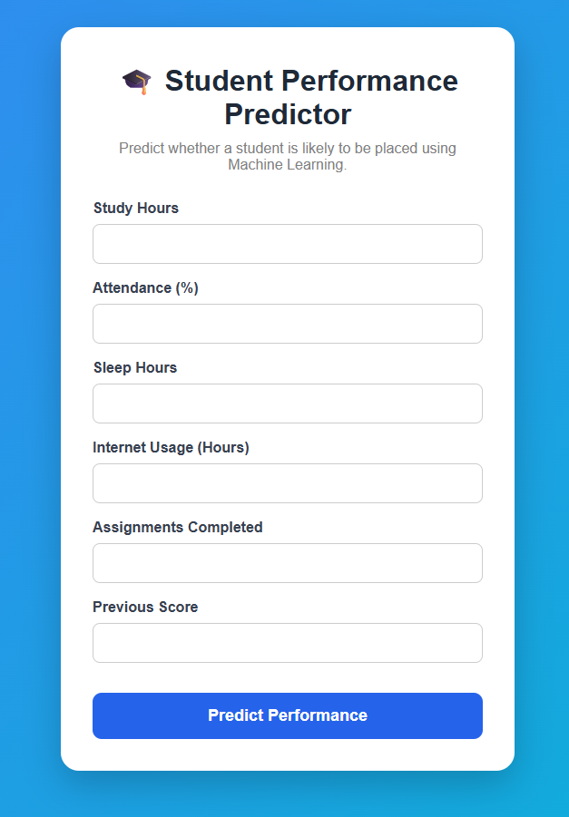
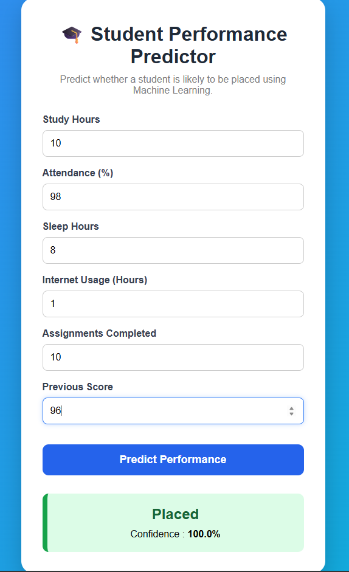
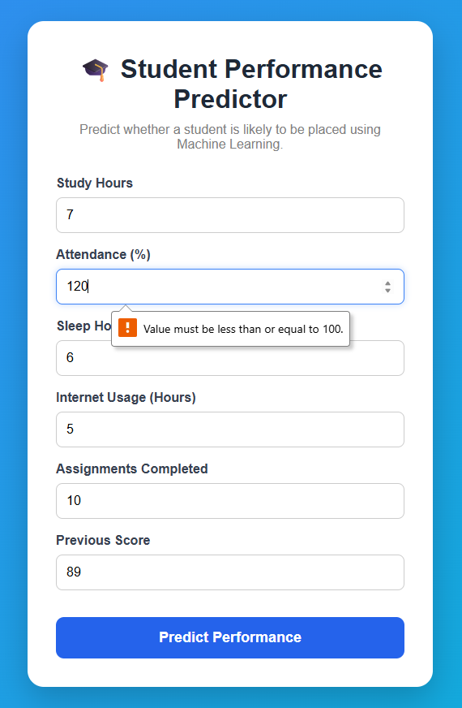

# 🎓 Student Performance Predictor


An **end-to-end Machine Learning web application** that predicts whether a student is likely to be **Placed** or **Not Placed** based on academic and behavioural factors.

This project demonstrates the complete Machine Learning workflow, from **data preprocessing** and **model training** to **model deployment** using **Flask**.

---

# 🌍 Live Demo

🚀 **Coming Soon**

*(Will be deployed on Render.)*

---

# 🚀 Features

- 🎯 Student Placement Prediction
- 📊 Prediction Confidence Score
- ✅ Input Validation
- 🤖 Random Forest Machine Learning Model
- 🌐 Flask Web Application
- 💾 Model Persistence using Joblib
- 🎨 Responsive User Interface
- 📁 Professional Project Structure

---

# 🛠️ Tech Stack

## Machine Learning

- Python
- Pandas
- NumPy
- Scikit-learn
- Joblib

## Backend

- Flask

## Frontend

- HTML5
- CSS3
- JavaScript

## Development Tools

- Git
- GitHub
- VS Code

---

# 📂 Project Structure

```text
Student-Performance-Predictor/
│
├── data/
│   └── Dataset.csv
│
├── notebooks/
│   └── experimentation.ipynb
│
├── saved_models/
│   └── random_forest_model.pkl
│
├── screenshots/
│   ├── home.png
│   ├── prediction.png
│   └── validation.png
│
├── src/
│   ├── evaluation/
│   ├── models/
│   ├── prediction/
│   ├── preprocessing/
│   ├── utils/
│   ├── load_data.py
│   ├── load_model.py
│   ├── predict.py
│   ├── save_model.py
│   ├── train.py
│   └── visualize.py
│
├── static/
│
├── templates/
│
├── app.py
├── requirements.txt
├── README.md
├── LICENSE
└── .gitignore
```

---

# 🔄 Project Workflow

```text
Dataset
   │
   ▼
Data Preprocessing
   │
   ▼
Feature Selection
   │
   ▼
Model Training
   │
   ▼
Random Forest Classifier
   │
   ▼
Model Serialization (.pkl)
   │
   ▼
Flask Backend
   │
   ▼
HTML/CSS Frontend
   │
   ▼
Prediction + Confidence Score
```

---

# 📊 Dataset Features

The model predicts placement status using the following features:

| Feature | Description |
|----------|-------------|
| Study Hours | Daily study duration |
| Attendance | Attendance percentage |
| Sleep Hours | Average sleep duration |
| Internet Usage | Daily internet usage |
| Assignments Completed | Number of completed assignments |
| Previous Score | Previous academic performance |

### Target Variable

- Placement Status

---

# 🤖 Machine Learning Model

### Algorithm Used

**Random Forest Classifier**

The model was trained using **Scikit-learn** and saved using **Joblib**, allowing it to be integrated directly into the Flask application without retraining.

---

# 🌐 Web Application

The Flask application allows users to:

- Enter student details
- Predict placement status
- View prediction confidence
- Validate invalid inputs
- Display prediction results instantly

---

# 📸 Screenshots

## 🏠 Home Page



---

## 📈 Prediction Result



---

## ✅ Input Validation



---

# ⚙️ Installation

## Clone the repository

```bash
git clone https://github.com/Shubh-938croton/Student-Performance-Predictor.git
```

## Move into the project directory

```bash
cd Student-Performance-Predictor
```

## Create a Virtual Environment

### Windows

```bash
python -m venv .venv
```

Activate it:

```bash
.\.venv\Scripts\activate
```

### macOS/Linux

```bash
python3 -m venv .venv
source .venv/bin/activate
```

---

## Install Dependencies

```bash
pip install -r requirements.txt
```

---

## Run the Application

```bash
python app.py
```

Open your browser and visit:

```
http://127.0.0.1:5000
```

---

# 📈 Learning Outcomes

Through this project, I gained practical experience in:

- Data preprocessing
- Feature engineering
- Machine Learning model training
- Model evaluation
- Model serialization using Joblib
- Flask web development
- Frontend integration with Machine Learning
- Input validation
- Debugging and testing
- Git & GitHub workflow
- Virtual environments
- Dependency management using `requirements.txt`

---

# 🔮 Future Improvements

- 📊 Interactive Dashboard
- 📈 Feature Importance Visualization
- 📜 Prediction History
- 🗄️ Database Integration (SQLite)
- 🔐 User Authentication
- 🌐 REST API
- 🧠 Explainable AI (SHAP)
- 🐳 Docker Support
- ☁️ Cloud Deployment
- 📱 Fully Responsive UI

---

# 👨‍💻 Author

## **Shubh Kamal**

**B.Tech Student**

Passionate about building intelligent web applications by combining **Machine Learning** and **Full Stack Development**.

### Connect with me

- GitHub: https://github.com/Shubh-938croton
- LinkedIn: https://www.linkedin.com/in/YOUR-LINKEDIN-USERNAME/

---

# 📄 License

This project is licensed under the **MIT License**.

See the **LICENSE** file for more information.

---

# ⭐ Support

If you found this project useful, consider giving it a **⭐ Star** on GitHub.

It motivates me to build more open-source projects and continue improving this repository.